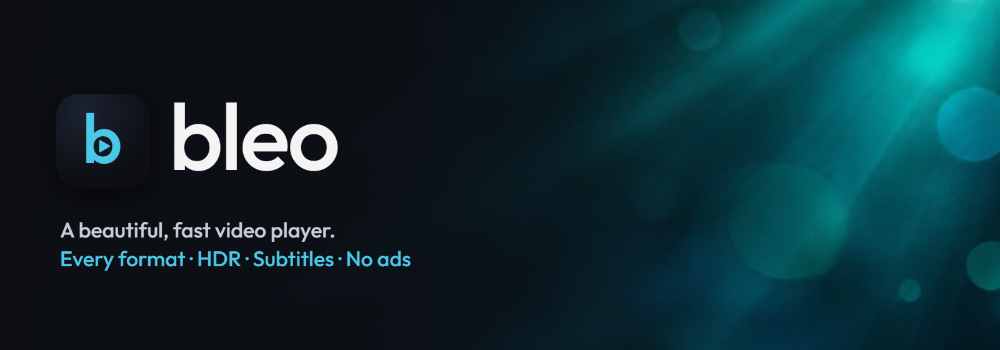
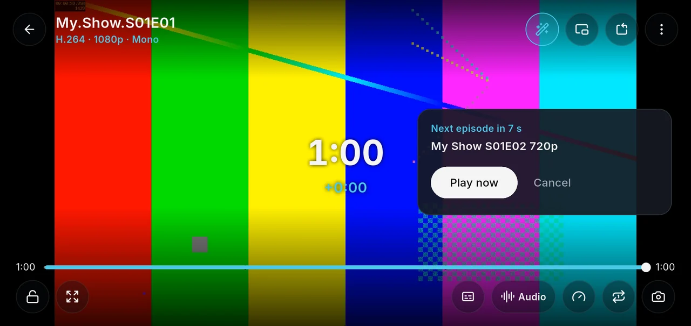
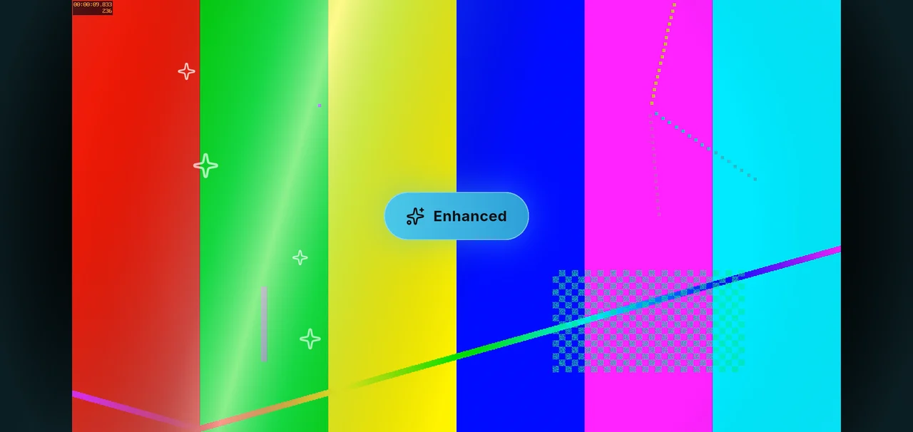
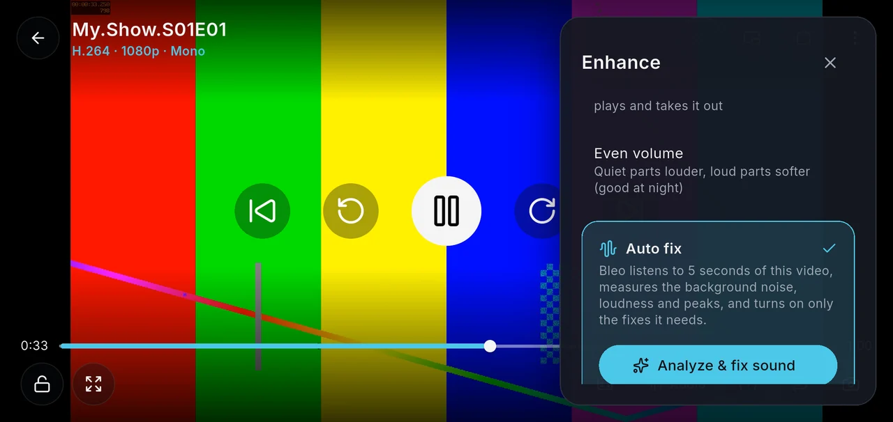
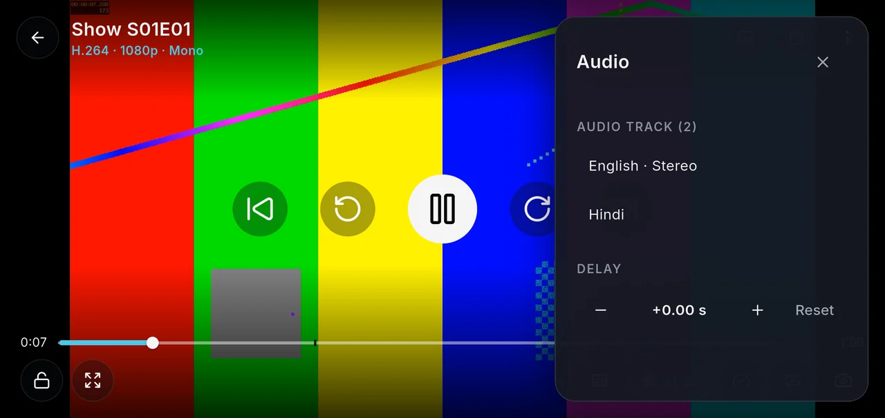
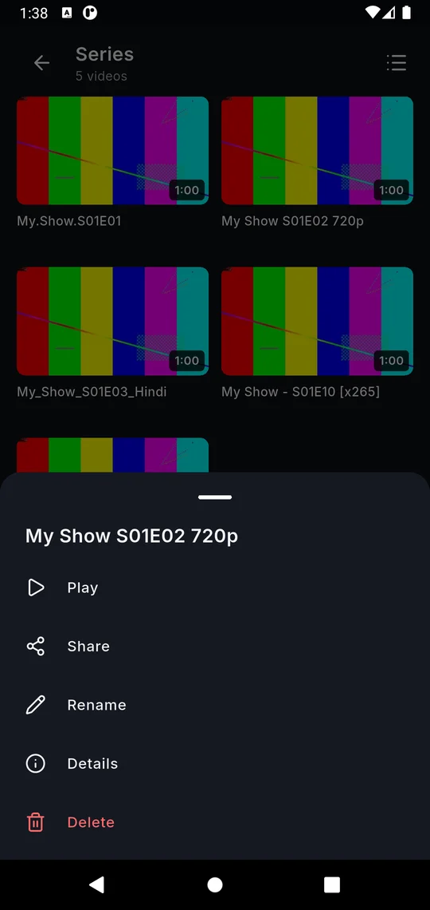
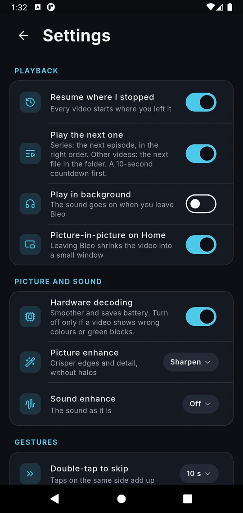
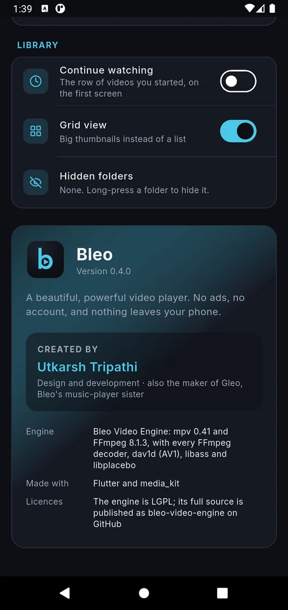

# Bleo

A free, powerful video player for **Android**. It plays every format: MKV, MP4, MOV, AVI, WebM, HEVC, AV1, ProRes and DNxHD, with HDR and every kind of subtitle. Your videos are shown by folder, like MX Player, with real thumbnails. **No ads, no account, and nothing leaves your phone.**

Bleo (said "BLAY-oh") is the Old English word *blēo*: colour, the look of things. It is the sister app of [Gleo](https://github.com/capsuleutkarsh-design/gleo), the music player.

## Download

Get the latest version from **[Releases](https://github.com/capsuleutkarsh-design/bleo/releases)**:

- **Android 8 or newer:** `Bleo-<version>-android-arm64.apk` (almost every phone from the last 6 years).

Bleo is in beta. Install a new version over the old one; your settings and resume points stay.

## What it does

- **Your videos by folder.** Every video on the phone and SD card, with thumbnails (even for ProRes), length, quality and size. There is also a Continue watching row, search, and grid or list view.
- **Knows your series.** `Show S01E03`, `1x03`, `Season 2 Episode 5`, `Part 2` and `part3` all play in the right order, even when the files are spelled differently. Next goes to the real next episode, with a *Next episode* button near the end.
- **Phone gestures.**
  - Left side: brightness. Right side: volume, which boosts past 100%.
  - Swipe sideways to seek. Double-tap to skip. Hold for 2×. Pinch to fill.
  - Lock, rotation that follows the phone, and picture-in-picture.
- **Tracks and subtitles.**
  - Switch audio tracks, add subtitle files, and set the subtitle colour, size, background, position and delay.
  - Audio delay, speed from 0.25× to 4×, A-B repeat, chapters and frame step.
- **One-tap Enhance.** Tap the wand: a light sweeps across the video, and the picture gets crisper detail, richer colour and more depth.
- **Better sound.** Clear voice, noise reduction and even volume. **Analyze & fix sound** listens to a few seconds and turns on only the fixes the sound needs.
- **Library tools.** Rename, delete, share, hide folders, sleep timer and screenshots to your gallery.

## Screenshots

**Next episode, in the right order**

**One-tap Enhance**

**Analyze & fix sound**

**Audio tracks**

**Long-press options, Settings and About**

## Licence

Bleo is free to use, made by Utkarsh Tripathi. It is not for sale. Please do not re-upload the app or remove the author's name. See [LICENSE.md](LICENSE.md).

Bleo's video engine (mpv + FFmpeg, LGPL) is built in public at [bleo-video-engine](https://github.com/capsuleutkarsh-design/bleo-video-engine).

Questions and bug reports: [capsuleutkarsh@gmail.com](mailto:capsuleutkarsh@gmail.com)
